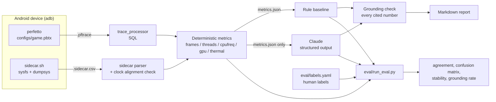

# perfetto-game-agent

A CLI that reads an Android [Perfetto](https://perfetto.dev) trace of a mobile
game and writes a **first-pass bottleneck report**: is the game CPU-bound on its
main thread, GPU-bound, mis-scheduled onto the wrong cores, thermally throttled,
blocked on I/O — or fine?

The design rule: **the LLM never computes numbers.** Metrics are extracted
deterministically with SQL over `trace_processor`; Claude only interprets the
resulting JSON, must cite every number by its JSON path, and every citation is
checked mechanically. A plain rule baseline makes the same call independently,
and an eval compares both against human labels.

> 中文摘要見[文末](#中文摘要)。

## Why

I built this to learn mobile-game performance analysis (frame pacing, big.LITTLE
scheduling, DVFS, thermal throttling) from first principles on a real device,
and to practise a way of using an AI agent I trust: let it do the reading and
the writing, but keep the arithmetic in code, check its citations, and measure
its judgement against labels instead of believing it.

## Architecture



| Layer | Module | Notes |
|---|---|---|
| Recording | `gpa record`, `configs/game.pbtx`, `device/sidecar.sh` | Config is kept parseable by on-device Perfetto v46 |
| Metrics | `metrics/{process,frames,threads,cpu_topology,cpufreq,gpu,thermal,meta}.py` | Each block has `available` + `reason`; missing data stays `null`, never `0` |
| Interpreters | `rules.py`, `llm.py` | Same output schema (`verdict.py`): category, confidence, evidence `{claim, metric_path, value}`, next steps |
| Verification | `grounding.py` | A citation passes only if the path exists and the value matches (1% / 0.01) |
| Eval | `evaluation.py`, `eval/run_eval.py` | Majority vote over N LLM runs, cached raw responses |

Categories: `cpu_bound_main_thread`, `gpu_bound`, `scheduling_placement`,
`thermal_throttling`, `io_or_other`, `no_clear_bottleneck`, `insufficient_data`.

## How to run

Requires [uv](https://docs.astral.sh/uv/) and Python ≥ 3.11. The first run
downloads the `trace_processor` binary pinned by `perfetto==0.58.2` (v57.2).

```bash
uv sync
uv run pytest                                   # 73 tests, synthetic traces, no device needed

# Record (see docs/RECORDING.md): phone on USB with USB debugging enabled, game running
uv run gpa record traces/mygame --duration 30

# Report: rules only (no API key) or rules + Claude
uv run gpa analyze traces/mygame.pftrace --no-llm
export ANTHROPIC_API_KEY=...                    # or `ant auth login`
uv run gpa analyze traces/mygame.pftrace        # default model claude-sonnet-5-5
uv run gpa analyze traces/mygame.pftrace --model claude-opus-5-5 --effort high

# Metrics JSON only
uv run gpa metrics traces/mygame.pftrace --out mygame.json

# Public smoke-test traces (not games; fetched + sha256-verified, not redistributed)
uv run python scripts/fetch_public_traces.py

# Eval
uv run python eval/run_eval.py --no-llm         # rule baseline only
uv run python eval/run_eval.py --runs 3         # + Claude, 3 runs per trace
```

The LLM call uses structured outputs (`output_config.format` with a strict JSON
schema), prompt caching on the static system prompt, and Anthropic's server-side
refusal fallback (`fallbacks: "default"`); the report records which model
actually answered.

Example outputs: [`examples/`](examples/).

## What the metrics are, and how each was checked

Everything below was verified against real traces (a Galaxy S24 and public
Perfetto test traces), not only synthetic tests. Several first designs were
wrong; the fixes are in the code with comments.

| Metric | Source | Verification / gotcha found |
|---|---|---|
| Frame present time | End of the SurfaceFlinger *display* frame sharing the app frame's `display_frame_token` | The app frame's own end (max(GPU done, post)) jittered 1–20 ms; SF-based intervals were clean vsync multiples (11.1 ms @ 90 Hz) |
| Jank types | `actual_frame_timeline_slice.jank_type`, stdlib `android_is_*_jank_type` | Real strings are `App Deadline Missed`, comma-joined combos — not the CamelCase in the docs. Buffer Stuffing is latency, not a missed frame |
| Frames for Unity/GLES games | atrace `queueBuffer` (outermost) on the producing thread | Two Unity titles produced **zero** app frames in FrameTimeline; without this fallback the tool picked SystemUI as "the game" |
| Key threads | Name rules (`UnityMain`, `UnityGfxDeviceW*`, `RenderThread*`, …) + main thread + top CPU users | Linux threads inherit their creator's name: one game had 20 idle `UnityMain`s; only busy matches are kept |
| Cluster placement | `cpu.cluster_id` ranked by capacity → hardware max freq → observed max | The stdlib little/medium/big mapping merged the S24's 3.15 GHz and 2.96 GHz clusters |
| Analysis window | Span of `sched` data | `trace_bounds` included stale packets: a 10 s recording looked 47 s long, under-reporting CPU use ~5× |
| GPU clock / busy / cap | Trace `gpufreq` if present, else sidecar | S24 kernel lacks `power/gpu_frequency`. `gpu_max_clock` turned out to be a *dynamic* cap, not the hardware max |
| Thermal | Trace thermal tracks, else sidecar zones + Android thermal status | Kernel thermal events were silent on the S24 |
| Sidecar clock alignment | Sidecar `scaling_cur_freq` vs trace `cpufreq` | 100% match at offset 0 vs 72–85% when shifted ±1–2 s |

## Eval

**Status: infrastructure complete, labels not yet collected.** As of this
commit `eval/labels.yaml` has 2 recorded traces and 0 human labels, and no LLM
run has been made (no API key was configured in the development environment).
There are therefore **no agreement numbers to report yet**, and none are
invented here. `eval/results/summary.md` will hold them once labels exist.

Protocol (in `eval/labels.yaml`):

1. Record 12–20 traces covering the categories on purpose: max graphics / high
   FPS (GPU-bound?), low graphics / high FPS (CPU-bound?), 20+ minutes of play
   (thermal), heavy background load (scheduling), recording without
   `frametimeline`/`gfx` (insufficient data), idle menus (no bottleneck).
2. Label each trace in the Perfetto UI **before** running the agent on it, with a
   one-sentence reason, and commit the labels (the commit time is the evidence of
   blind labelling).
3. `run_eval.py` reports LLM–human, rule–human and LLM–rule agreement, 7×7
   confusion matrices, per-trace differences, run-to-run stability over N LLM
   runs, and the share of cited numbers that pass grounding.

Known limitations, before any number exists:

- **Small n.** With 15 traces one trace is ~7 points of agreement; results are
  anecdotes with a direction, not accuracy estimates.
- **One labeller, and a novice.** I am learning the domain with this project;
  labels can be wrong. Labeller confidence is recorded per trace.
- **Circularity.** I label by looking at the same signals the metrics summarise,
  so agreement partly measures whether the LLM reads the metrics the way I do.
- **One device, one SoC (Snapdragon 8 Gen 3)**, Unity-heavy game sample.
- **Category imbalance** is likely; the confusion matrix matters more than the headline.

### Error analysis so far (rule baseline, pre-labels)

Not eval results — observations from developing against two real game traces:

- **`cytus2_a` → rules say `thermal_throttling`.** Evidence: FPS fell from 114 to
  93 between the first and last third; thermal status was 1 (LIGHT); max CPU
  frequency in the last third was 0.65–0.71× the first third. But temperatures
  were *falling* (CPU subsystem 66 → 53 °C), and CPU caps of 33–40% of hardware
  max covered 97% of the recording — the same caps appeared in another game at
  43 °C with thermal status 0. The "frequency decline" may simply be a vendor game
  power policy engaging a moment after the recording started. This is a likely
  **false positive** of the rule that treats a falling max frequency as thermal
  evidence; the LLM prompt warns about exactly this, which makes it a good test
  case once labelled.
- **`dynamix_menu` → `no_clear_bottleneck`** (59.9 fps, 1% low 46 fps on a static
  menu). Plausibly right; it says nothing about gameplay.
- **Public Gmail trace → `insufficient_data`** (116 frames < 300): a UI app that
  renders on demand. The rule refuses rather than guesses, which is the intent.

## Next steps

- **Collect labels and run the eval**; publish confusion matrices and every
  disagreement, including the ones that make the LLM look bad.
- **Experiment automation:** script `gpa record` + `adb shell input` to replay a
  fixed scene N times per setting (graphics level, FPS cap, power mode, Game
  Booster on/off), so each comparison is a distribution instead of one run.
- **Compare tuning parameters:** run the same scene with different uclamp /
  cpuset / ADPF hints or thermal states, and diff the metrics JSON.
- **Power:** add `android.power` battery counters / ODPM rails to bring energy
  per frame into the report (needs adb over Wi-Fi so USB charging does not
  pollute readings).
- **MCP tool:** expose `metrics`, `classify` and per-metric drill-down SQL as MCP
  tools so an agent can ask follow-up questions of the trace instead of one-shot
  classification.
- **Cheaper sidecar:** replace the per-sample `sleep` fork (half of the ~8%-of-a-core
  overhead) with a shell-builtin timed wait; a coprocess-based wait worked once on
  the S24 but is not finished.
- Per-frame attribution (which thread was on the critical path for each slow frame).

## Repository layout

```
configs/game.pbtx            Perfetto config (v46-compatible)
docs/RECORDING.md            device setup, recording, sidecar, troubleshooting
src/gameperf_agent/          CLI, metrics, rules, LLM, grounding, report, eval logic
src/gameperf_agent/device/   on-device sidecar sampler
eval/                        labels.yaml, run_eval.py, results/
examples/                    sample reports
scripts/                     fetch_public_traces.py
tests/                       unit tests; synthetic traces built in tests/synth.py
```

Traces are never committed (`traces/` is git-ignored): they are large, the
public ones have no explicit redistribution license, and device traces contain
the full process list of a personal phone.

## License

Apache-2.0.

---

## 中文摘要

**這是什麼：** 一個 Python CLI。輸入 Android Perfetto trace，輸出手遊效能瓶頸的初判報告（Markdown）。

**設計原則：** 數字全部由程式用 SQL 從 trace 萃取；Claude 只看萃取後的指標 JSON，每個判斷依據都必須附上指標路徑和數值，再由程式逐一核對（grounding）。另外有一個規則 baseline 獨立判讀，eval 會把兩者都拿來跟人工標註比較。

**實機驗證的重點發現（Galaxy S24、Snapdragon 8 Gen 3）：**
- Unity 遊戲不會在 FrameTimeline 產生 app frame，必須改用 atrace 的 `queueBuffer` 算 FPS。
- Linux thread 會繼承建立者的名稱，一款遊戲裡有 20 條閒置的 `UnityMain`。
- `trace_bounds` 會把錄製前的舊資料算進去，讓 CPU 使用率被低估約 5 倍。
- S24 的 kernel 沒有 GPU 頻率的 ftrace event，所以加了 sidecar 從 sysfs 取樣；時間對齊經過驗證。
- 遊戲一開，CPU 頻率上限就被壓到硬體上限的 33～40%，連 43°C 時也一樣。這比較像廠商的遊戲省電策略，**不能直接當成 thermal 降頻**。

**Eval 現況：** 程式和流程都已完成，但人工標註還沒做、LLM 也還沒實際跑過（開發環境沒有 API key），所以**目前沒有任何準確率數字**。README 不會先寫任何數字。

**限制：** 樣本小、標註者只有一人而且是新手、標註看的指標和 agent 看的高度重疊、只有一台裝置。
